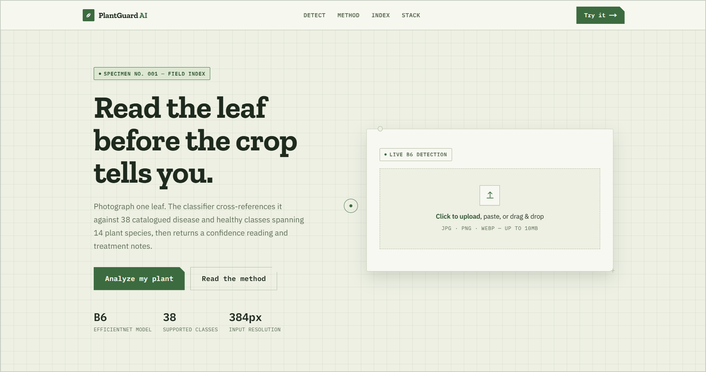
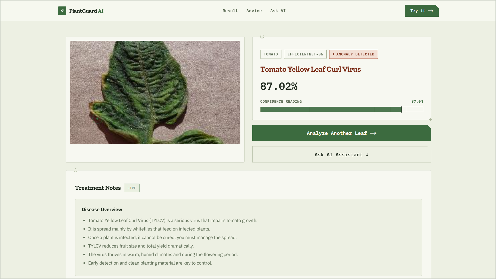
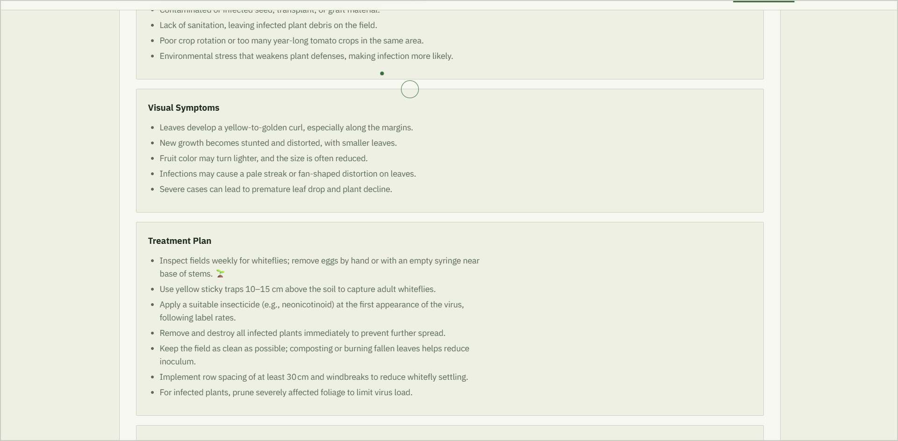
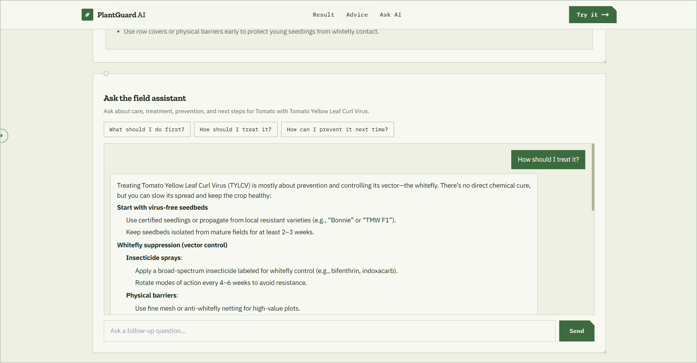
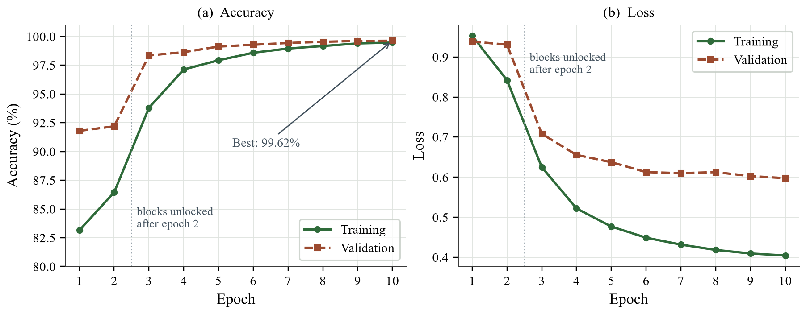
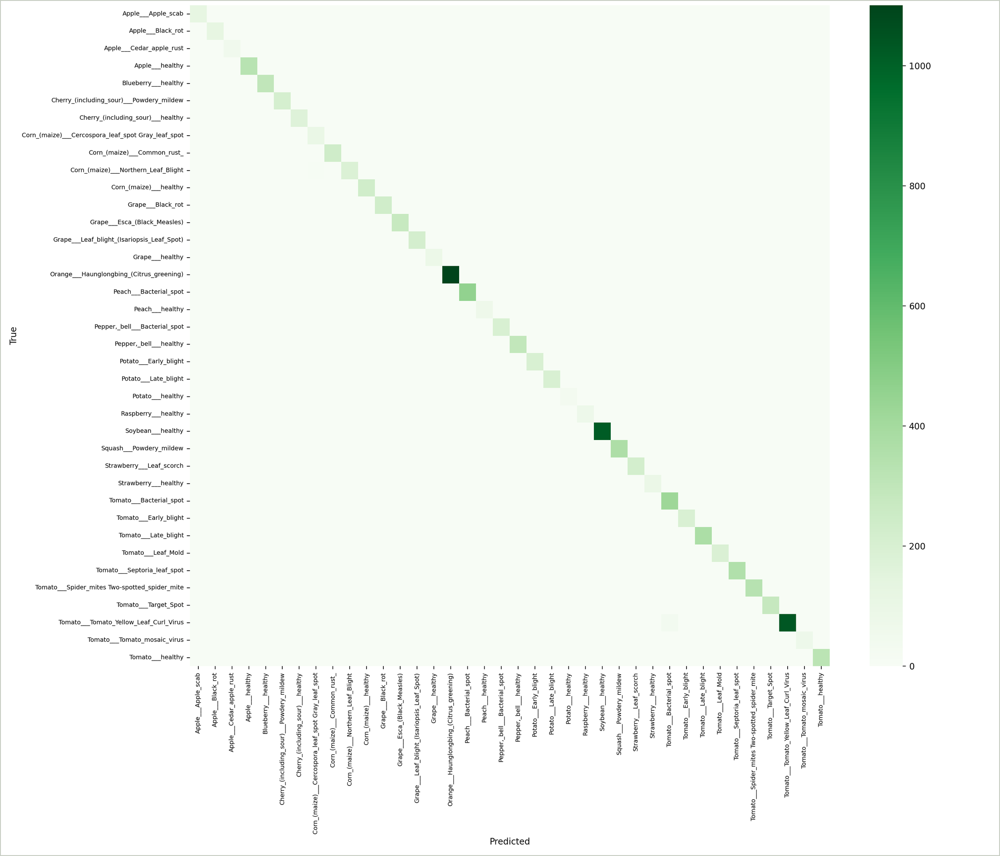
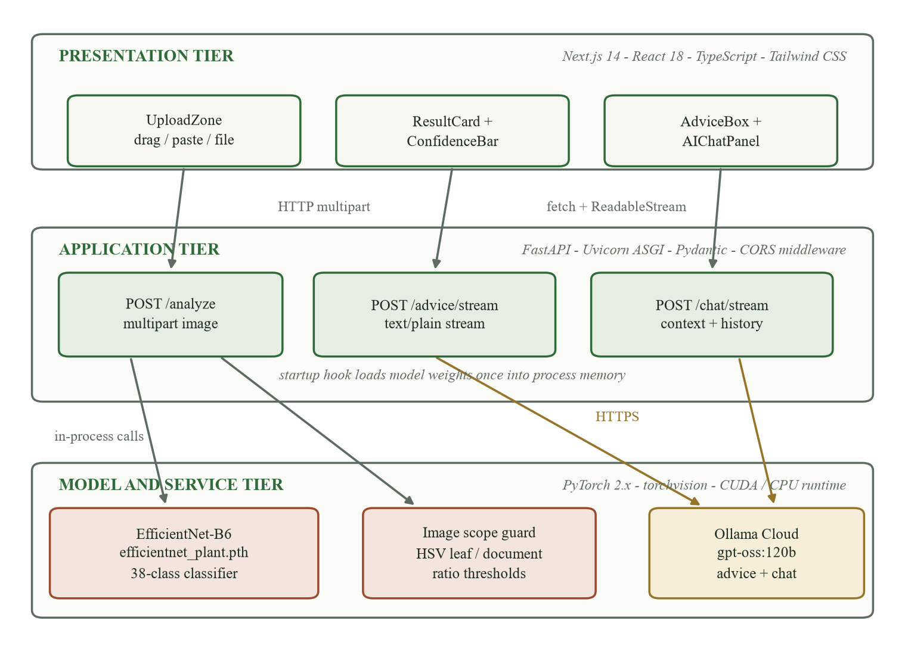
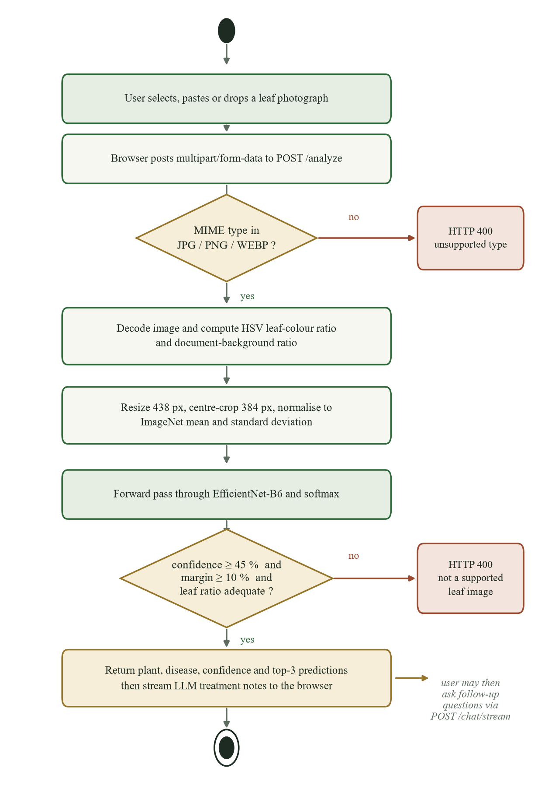
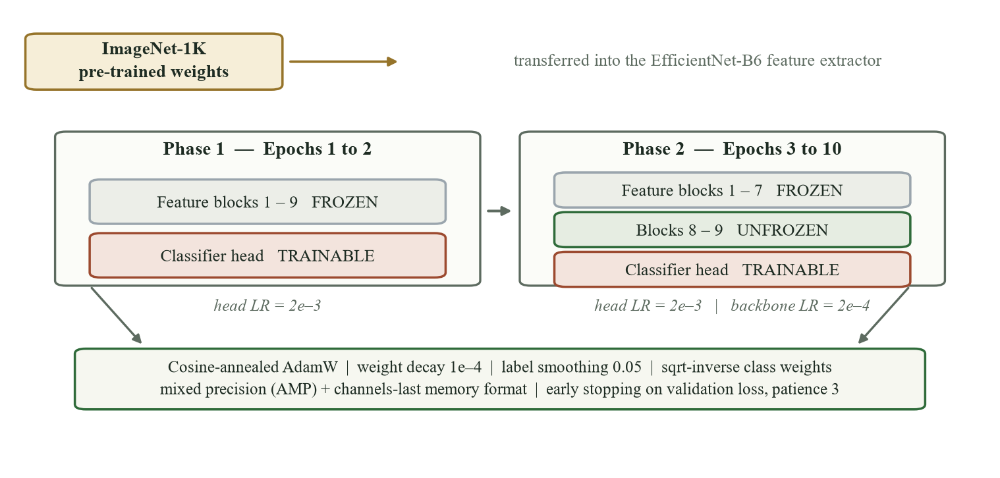
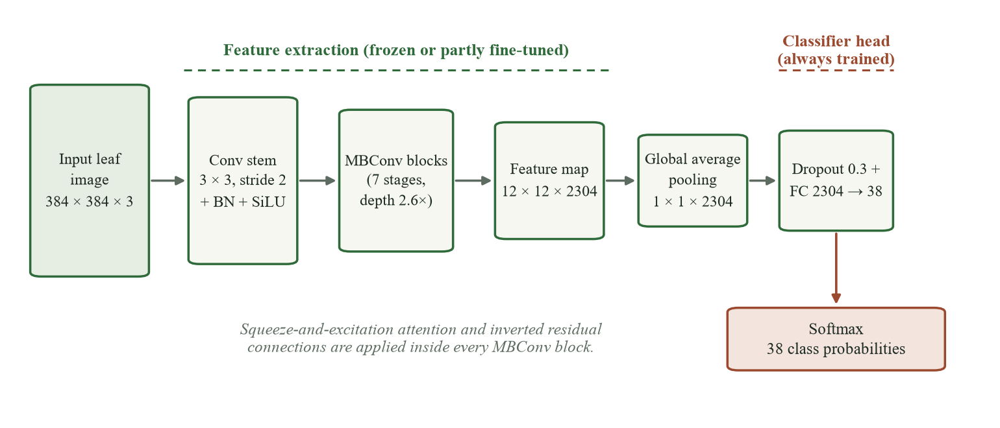

# PlantGuard AI 🌿

A web app that looks at a photo of a plant leaf and tells you **which disease it has, how sure it
is, and what to do about it**. Built on an **EfficientNet-B6** deep learning model (PyTorch)
trained on the PlantVillage dataset, plus an AI assistant that turns the diagnosis into plain-language
treatment and prevention advice.

**99.62 % validation accuracy** on 10,876 unseen images · **38 classes across 14 crops** ·
diagnosis in **1–2 seconds** · refuses screenshots, people and unknown crops instead of guessing.



## Why this exists

A farmer usually finds out what is wrong with a plant by calling an expert (accurate, but slow and
costly), checking a printed guide (hard to match to what is on the leaf), or asking a neighbour or
a shopkeeper (fast, but often wrong). A photo taken on an ordinary phone already holds most of what
an expert looks at, so this is a natural job for image classification.

PlantGuard AI does it in two stages:

1. **See** — a convolutional neural network identifies the disease from one leaf photo.
2. **Explain** — a large language model writes causes, symptoms, treatment and prevention for that
   exact disease, and answers follow-up questions in a chat.

The model never guesses at things it was not trained on: a colour-and-confidence check rejects
screenshots, documents, people and unsupported crops before an answer is shown.

## Features

- **Upload any way you like** — click, drag and drop, or paste an image (JPG, PNG, WEBP, up to 10 MB).
- **Diagnosis with honest confidence** — plant, disease, a confidence bar and the top three
  predictions, so a close call looks like a close call.
- **Invalid image guard** — an HSV leaf-colour ratio, a document-background ratio, a minimum
  confidence and a minimum margin between the top two answers. A PDF renamed to `.png`, a web-page
  screenshot, a photo of a person and an unsupported crop are all refused in testing.
- **Streamed treatment notes** — the advice appears line by line within 1–3 seconds instead of
  after a long wait, with fixed sections: overview, causes, visual symptoms, treatment plan, prevention.
- **Context-aware chat** — ask "How should I treat it?" or "How do I prevent it next time?"; the
  assistant already knows the diagnosis and the conversation so far.
- **Works without the LLM** — a built-in knowledge base (`backend/diseases.json`) gives
  disease-specific advice when the AI service is unreachable, and the diagnosis itself runs locally.
- **Pick your LLM** — Ollama Cloud, a local Ollama install, or OpenRouter (free models work), set in
  one `.env` line.
- **Disease library** — browse all 38 supported classes in the app.
- **Mobile friendly** — the layout adapts to phone browsers.



| Treatment notes | Follow-up chat |
|---|---|
|  |  |

## Results

| | |
|---|---|
| Best validation accuracy | **99.62 %** (epoch 10, 10,876 unseen images) |
| Final training accuracy | 99.46 % (on augmented training images) |
| Dataset | PlantVillage colour set — 54,305 images, 38 classes, 14 crops |
| Split | 43,429 train / 10,876 validation, no duplicate photo on both sides |
| Class imbalance | 36 : 1 (5,507 citrus-greening vs 152 healthy-potato images), handled with balanced sampling and class weights |
| Model | EfficientNet-B6, ~43 million parameters, 384 × 384 input |
| Training time | 5 h 4 min, 10 epochs, on one NVIDIA GPU |
| Model load / diagnosis | 5–8 s at server start / 1–2 s per image |



The jump at epoch 3 is where the last two EfficientNet blocks are unfrozen (two-stage transfer
learning, below). Validation accuracy sits above training accuracy because only the training images
are augmented.



The few remaining mistakes are between diseases that look alike even to a person: tomato bacterial
spot vs yellow leaf curl virus, early blight vs late blight vs target spot, apple scab vs black rot.
Healthy leaves are almost never called diseased, and diseased leaves are almost never called healthy.

> **Honest footnote:** PlantVillage photos are single leaves on a plain background under even light.
> Accuracy on real field photos (soil, shadows, several leaves in frame) has not been measured and
> will be lower.

## How it works



```
Browser (Next.js)        upload → POST /analyze
FastAPI backend          decode → leaf-colour check → resize 438 / centre-crop 384 → EfficientNet-B6 → softmax
                         reject if not a supported leaf, else return plant, disease, confidence, top 3
                         POST /advice/stream → LLM (or knowledge base) → advice streamed to the browser
                         POST /chat/stream   → follow-up answers with diagnosis + history as context
```



### Training: two-stage transfer learning



EfficientNet-B6 starts from ImageNet weights; its 1000-class head is replaced by a 38-class head.



- **Stage 1 (epochs 1–2):** backbone frozen, only the new head learns (LR 2e-3).
- **Stage 2 (epochs 3–10):** the last two blocks are unfrozen with a 10× smaller LR (2e-4).
- AdamW with cosine annealing, weight decay 1e-4, label smoothing 0.05, square-root inverse class
  weights, mixed precision (AMP), early stopping on validation loss (patience 3).
- Augmentation during training only: flips, small rotations, brightness and contrast jitter.

### API

| Endpoint | Method | Input | Output |
|---|---|---|---|
| `/` | GET | — | server status, model name, number of classes |
| `/analyze` | POST | image file | plant, disease, confidence, top 3 predictions |
| `/advice/stream` | POST | disease, plant, confidence | treatment advice, streamed |
| `/chat` | POST | question + diagnosis | full reply |
| `/chat/stream` | POST | question + diagnosis + history | reply, streamed |

Interactive docs at `http://localhost:8000/docs` once the backend is running.

## Install and run

You need **Python 3.10+**, **Node.js 18+**, and an API key for one LLM provider (Ollama Cloud or
OpenRouter — or a local Ollama, which needs no key).

1. **Get the code**
   ```bash
   git clone https://github.com/Param-2811/PlantGuard-AI.git
   cd PlantGuard-AI
   ```
2. **Model weights** — download `efficientnet_plant.pth` from the
   [latest release](../../releases/latest) and put it in `backend/weights/`.
3. **LLM settings** — copy `.env.example` to `backend/.env` and fill in your own key.
   `LLM_PROVIDER` is `ollama_cloud`, `ollama_local` or `openrouter`. Never commit `.env`.
4. **Backend**
   ```bash
   cd backend
   python -m venv venv
   venv\Scripts\activate          # macOS/Linux: source venv/bin/activate
   pip install -r requirements.txt
   uvicorn main:app --port 8000
   ```
5. **Frontend** (second terminal)
   ```bash
   cd frontend
   npm install
   npm run dev
   ```
6. Open **http://localhost:3000**.

On Windows, **`start.bat`** starts both servers, waits until they are ready and opens the browser;
press **Q** to stop them. Full guide and troubleshooting: [SETUP.md](SETUP.md).

## Train it yourself

1. Download the [PlantVillage dataset](https://www.kaggle.com/datasets/abdallahalidev/plantvillage-dataset)
   and use its `color` folder.
2. Set `DATASET_PATH` in `training/train.py` and `training/evaluate.py`.
3. ```bash
   python training/analyze_dataset.py   # class counts and imbalance chart
   python training/train.py             # writes backend/weights/efficientnet_plant.pth
   python training/evaluate.py          # accuracy and confusion matrix
   ```

A GPU is strongly recommended; the reference run took about 30 minutes per epoch.

## Supported crops and conditions

Apple (scab, black rot, cedar apple rust, healthy) · Blueberry (healthy) · Cherry (powdery mildew,
healthy) · Corn (gray leaf spot, common rust, northern leaf blight, healthy) · Grape (black rot,
esca, leaf blight, healthy) · Orange (citrus greening) · Peach (bacterial spot, healthy) ·
Bell pepper (bacterial spot, healthy) · Potato (early blight, late blight, healthy) ·
Raspberry (healthy) · Soybean (healthy) · Squash (powdery mildew) · Strawberry (leaf scorch, healthy) ·
Tomato (bacterial spot, early blight, late blight, leaf mold, septoria leaf spot, spider mites,
target spot, mosaic virus, yellow leaf curl virus, healthy)

## Built with

| What | Why it is here |
|---|---|
| [PyTorch](https://pytorch.org) + [torchvision](https://pytorch.org/vision) | EfficientNet-B6 model, training and inference |
| [FastAPI](https://fastapi.tiangolo.com) + Uvicorn | Backend API with streamed responses |
| [Next.js 14](https://nextjs.org) + React 18 + TypeScript | The web app |
| [Tailwind CSS](https://tailwindcss.com) | Styling |
| [Ollama](https://ollama.com) / [OpenRouter](https://openrouter.ai) | The language model behind advice and chat |
| [PlantVillage](https://arxiv.org/abs/1511.08060) | Training data (Hughes & Salathé, 2015) |

## Project report

The full write-up — problem, method, training results, architecture, testing (11 browser test
cases, all passing) and limitations: [PDF](docs/PlantGuard_AI_Report.pdf) ·
[Word](docs/PlantGuard_AI_Report.docx)

## Limitations and next steps

- Trained on clean lab photos; needs fine-tuning on real field photos.
- Only the 38 PlantVillage classes; one disease per image; no severity estimate.
- Advice needs an internet connection (the diagnosis does not).
- English only — regional-language output is mostly a prompt change and is the next planned step.
- An ONNX export script (`backend/export_onnx.py`) is the first step toward offline use on phones.

**Searching for any of these?** *Plant disease detection using deep learning*, *leaf disease
classification with EfficientNet*, *PlantVillage PyTorch project*, *crop disease detection web app*,
*AI agriculture project with FastAPI and Next.js*, *tomato / potato / apple leaf disease detector*.

## License

[MIT](LICENSE) © Param Patel. Issues and pull requests welcome.
